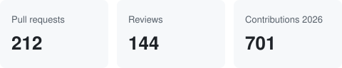

## Hi, I'm Thotsawat

Senior backend developer. I build APIs and data pipelines for IoT energy monitoring and billing, taking device telemetry through time-series aggregation and all the way to invoices.

### Tech stack

  

Also: QuestDB, ArgoCD, K3s, CloudFormation, Cognito

### Activity

